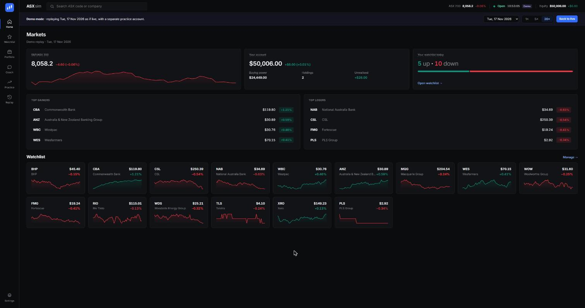
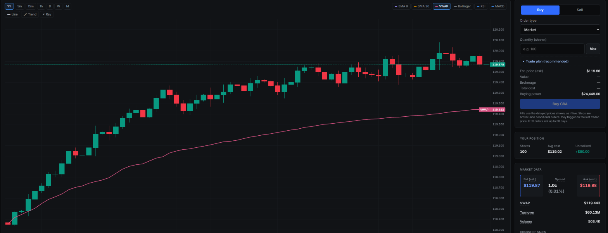
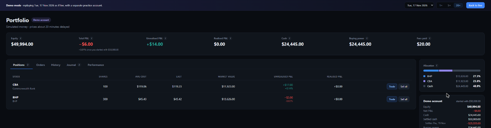
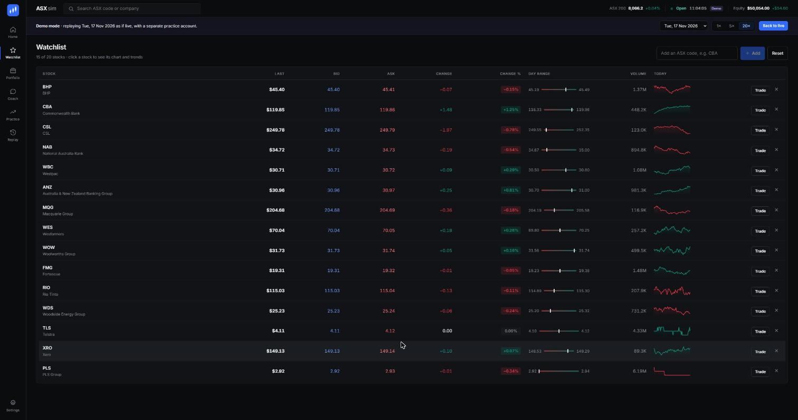
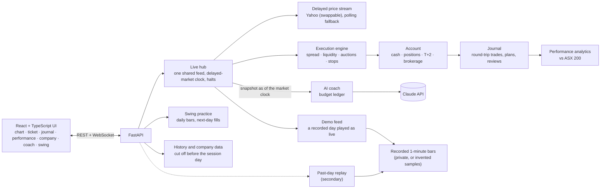

# ASX-sim

[](https://github.com/AryavKarthik/ASX-sim/actions/workflows/ci.yml)

[](LICENSE)

**A realistic ASX day-trading simulator on the live market, with an AI coach.**

Trade ASX shares **during today's trading session**, on free market data that runs about
20 minutes behind the real exchange. Prices stream in continuously, every time a new
(delayed) price is published, and your simulated orders fill against that live feed under
the same rules as the real market:
- the pre-open phase and the opening single price auction,
- ASX tick sizes and bid/ask spreads,
- liquidity limits and partial fills,
- brokerage and T+2 settlement,
- the closing single price auction.

Then you review every trade with a journal, performance analytics and a Claude-powered
coach that challenges your reasoning instead of handing out tips. A separate swing-practice
mode lets you trade through months of daily prices in an evening.

> **Status:** v1.1 ([releases](https://github.com/AryavKarthik/ASX-sim/releases)). The
> planned three-week build is complete, plus broker-style stock pages, chart drawing tools
> and a professional redesign. It is a personal learning tool: simulated money only, and
> nothing here is financial advice.



| A stock: chart, order ticket and market data | Portfolio: today's P&L, positions and allocation |
|---|---|
|  |  |



*Screenshots use invented sample prices in demo mode (see [Market data and licensing](#market-data-and-licensing)).*

---

## How the 20-minute delay works

Real-time ASX data costs money. Free data (Yahoo Finance) is delayed by about 20 minutes but
still updates continuously. ASX-sim embraces that: **the simulator's market is the real ASX
running 20 minutes behind.**

- If you only watch prices inside ASX-sim, trading feels live. At 10:20am your time you see
  the 10:00 open, and every price change arrives as it is published.
- Your orders are matched against the prices as they arrive, in order, so you can never act
  on a price before the market "reached" it.
- Market phases (pre-open, opening auction, closing auction) follow the same delayed clock.
- The data layer is swappable. Plugging in a real-time feed later (for example Interactive
  Brokers) removes the delay without changing the rest of the app.

## Features

**A clear, page-based interface** that follows broker-platform conventions (neutral surfaces, one accent colour, aligned figures, subtle motion):
- a sidebar with **Home**, **Watchlist**, **Portfolio**, **Coach**, **Practice** and **Replay**, a stock search in the top bar, and an ASX 200 ticker, the market's phase, the delayed clock and your equity always visible,
- **a page for every stock** (`#/stock/BHP`), with what a broker shows:
  - price, change, bid and ask, and trends from today to 3 years with the 52-week range,
  - a large chart, the order ticket, and a market-data panel: bid/ask/spread, VWAP, turnover
    and a live **course of sales** (each trade's time, price and size). Yahoo sends bid and
    ask only occasionally; when they're missing or stale the app shows the one-tick estimate
    the simulator fills against, labelled "est.",
  - tabs for **Overview** (trading, valuation, technicals with 50/200-day averages, and
    performance against the ASX 200), **Financials** (income, margins, balance sheet),
    **Dividends** (yields, payout and payment history), **Analysts** (consensus rating and
    price targets), **Company** (profile, ownership, management) and your activity,
- **Portfolio**: equity, **today's P&L** (overnight shares from yesterday's close, today's buys from their cost), total, unrealised and realised P&L, cash and buying power; positions with day change, cost base, weight and a Trade button; orders, history, journal, performance and allocation,
- **Watchlist**: last price, bid and ask, change, a day-range bar, volume and today's trend line,
- a **Trade** panel that slides in from any watchlist or portfolio row,
- jargon explains itself: terms like P/E or VWAP have a dotted underline with a plain-English
  tip on hover,
- subtle motion: prices flash green or red as they move, pages fade in, data loads behind
  shimmer placeholders (all switched off if your system asks for reduced motion).

**Core: live day trading on delayed data**
- A streaming feed of delayed prices, updated on every new price (not once a minute),
  with a 15-second polling fallback if the stream drops.
- A live candlestick chart and quote that update tick by tick, plus a delayed-market clock and
  phase badge.
- **Realistic execution:**
  - market, limit, stop, stop-limit and trailing-stop orders; good-for-day or good-till-cancelled,
  - fills modelled from real volume: a one-tick spread, a cap on how much of each
    minute's volume you can take, partial fills, and a queue estimate for limit orders.
- **ASX market structure:** trading calendar and public holidays, pre-open, opening and
  closing single price auctions with the ASX's randomised timing, and trading halts
  (inferred from the feed, with a reopening auction).
- **Account mechanics:** cash vs settled cash (T+2), average cost, realised and unrealised
  P&L, brokerage on every order. Long only: no short selling or margin.
- **Charts:**
  - candlesticks and volume at 1, 5, 15 and 60 minutes (built from the session's 1-minute
    candles), plus daily, weekly and monthly with up to decades of history,
  - indicators you can switch on: EMA 9, SMA 20, VWAP, Bollinger Bands, and RSI and MACD in
    their own panels. Each has a plain-English explanation on hover,
  - long-term history stops before the session day, and weekly/monthly bars are built from
    daily bars after that cut-off, so a demo can't see how its own day ends,
  - **drawing tools:** horizontal lines for support and resistance (snapped to real ASX
    prices, labelled on the price axis), trend lines and rays. Drag to move, drag an end to
    adjust, Delete to remove. Lines are anchored to time and price, so they stay in place
    across zooming and every timeframe, and each stock keeps its own (saved in your browser).
- **Risk planner** (`#/planner`, or the Plan button on any stock page):
  - drag entry, stop-loss and target lines on the chart (or type them, with one-step −/+
    buttons); the profit and loss zones are shaded green and red,
  - position sizing from the risk you choose (a % of your account or a dollar amount), so
    hitting the stop loses about that much **including brokerage both ways**, capped by
    buying power,
  - max loss, potential gain, reward-to-risk, the win rate you'd need to break even,
    breakeven price, position size as a share of the account, and plain-English warnings
    (more than 2% at risk, target closer than the stop, under the $500 first-parcel minimum),
  - a "what if it goes to…" slider and line, plus a ladder of outcomes at the stop, +1R,
    +2R, +3R, breakeven and the target,
  - a notebook (name, setup, notes and an editable pre-trade checklist) with saved plans
    kept beside your account, and **Place this trade**, which fills in the order ticket with
    the plan attached to the journal.
- **Trade journal:**
  - fills are grouped into round-trip trades automatically,
  - write your plan (setup, reason, stop, target) on the order ticket and see the risk/reward
    before you buy,
  - review each trade (followed the plan?, what went well, what to improve, emotions, rating),
  - each trade's **R-multiple** (P&L in units of the risk you planned) is worked out for you.
- **Performance analytics** (Portfolio → Performance):
  - equity curve against the ASX 200 rescaled to your starting cash. The index never uses
    data past the market clock, so a demo can't leak the rest of the day,
  - net P&L and return vs the ASX 200, win rate, profit factor, payoff ratio, expectancy,
    average R, max drawdown, Sharpe ratio (once there are 5+ trading days), fees as a share of
    gross profit,
  - results by setup, by time of day and by stock, and a discipline check comparing trades
    where you followed your plan with trades where you didn't.
- **Company data** on each stock page: valuation ratios (market cap, P/E, yield, price to
  book) are worked out from the price on screen, so they move with it and a replay never sees
  ratios built from a later price; dividend history stops before the session day.
- **AI coach (Claude)** on the Coach page ([ADR 0010](docs/adr/0010-ai-coach.md)):
  - ask anything about trading, with replies streamed as they are written. The coach sees
    your account, positions, open orders, journal and statistics, and the stock you're
    watching,
  - a **Full review** button for a deeper review of your journal and statistics,
  - a coach, not a tipster: it explains, questions your plan and reviews your trades, and
    won't say what to buy or sell or predict prices,
  - it only sees the market up to the (delayed or replayed) market clock,
  - cheap by design: Claude Haiku for chat and Claude Sonnet for reviews, with a monthly
    budget the app enforces (default US$10). Needs your own API key in `.env`; without one
    the coach is simply switched off.

**Swing practice: months of daily bars in an evening** ([ADR 0011](docs/adr/0011-swing-practice-on-daily-bars.md))
- Pick a stock and a period (or take a surprise), then step forward one trading day, week
  or month at a time. You only ever see up to "today's" close.
- Market, limit and stop orders fill on the following days. A price that gaps past your
  stop fills at the open, as in real life.
- **Blind practice:** a mystery stock from a random date, with the name and dates hidden
  until the end, so you can't trade on what you remember.
- Your result is measured against simply buying and holding the same stock.
- The same drawing tools as the live chart, saved per session.
- The server never sends a bar beyond the current day; sessions are saved so you can pick
  one up later.

**Secondary: look back at past days**
- Replay a recorded past trading day minute by minute, to review what happened or practise
  outside market hours. It uses a replay clock and a time gate so it never shows the future.

## Architecture



One rule runs through the whole design: **nothing may see past the market clock.** Fills,
the ASX 200 benchmark, long-term charts, company ratios, the coach's snapshot and swing
practice are each cut off at "now", whether that is the delayed live market or a replayed
day, and the cut-offs are covered by tests.

Key design decisions are recorded as [Architecture Decision Records](docs/adr/):

| ADR | Decision |
|---|---|
| [0004](docs/adr/0004-data-licensing.md) | Market data is never committed or published |
| [0007](docs/adr/0007-live-delayed-trading-is-the-core.md) | Live trading on delayed data is the core |
| [0008](docs/adr/0008-execution-model.md) | How simulated orders fill |
| [0009](docs/adr/0009-inferred-trading-halts.md) | Trading halts are inferred from the feed |
| [0010](docs/adr/0010-ai-coach.md) | The AI coach teaches and reviews; it never tips |
| [0011](docs/adr/0011-swing-practice-on-daily-bars.md) | Swing practice on daily bars |

## Built with

- **Backend:** Python 3.12, FastAPI (REST and WebSocket), pandas, Parquet and DuckDB for
  bars, `exchange_calendars` for ASX trading days, `yfinance` for delayed prices, the
  Anthropic SDK for the coach. Money is `Decimal` throughout. Checked with ruff, strict mypy
  and pytest (with Hypothesis).
- **Frontend:** React 19, TypeScript and Vite; TradingView Lightweight Charts with a custom
  plugin layer for the drawing tools; one hand-written stylesheet as the design system;
  Vitest for the maths.
- **Tooling:** uv, GitHub Actions CI, pre-commit with a secret scanner, Conventional Commits,
  and Architecture Decision Records.

## Market data and licensing

ASX-sim's **code** is open source (MIT). **Market data is never committed or published.**
Prices come from Yahoo Finance via `yfinance` for personal, non-commercial use: a live
stream of delayed prices for trading, plus a scheduled job that records each day's 1-minute
bars into a *private* repository for charts and past-day review. See
[ADR 0004](docs/adr/0004-data-licensing.md).

Because real prices can't be published, the repository includes a generator for **invented
sample prices** (`python -m asxsim.data.sample`). The screenshots above use it, and so can
you, to try the demo without downloading anything.

## Getting started

Requires [uv](https://docs.astral.sh/uv/) (it installs the right Python version
automatically) and [Node.js](https://nodejs.org/) 20+.

**1. Get some data for the demo.** Either make up three sample days (instant, no network):

```bash
git clone https://github.com/AryavKarthik/ASX-sim.git
cd ASX-sim/backend
uv sync
uv run python -m asxsim.data.sample --out ../../ASX-sim-data/bars_1m
```

or record the last week of real 1-minute bars for a few stocks, for your own use:

```bash
uv run python -m asxsim.data.recorder --out ../../ASX-sim-data/bars_1m --symbols BHP CBA CSL
```

Live trading, long-term charts, company pages and swing practice fetch from Yahoo as you
use them and need no recorded data.

By default the app reads data from an `ASX-sim-data` folder next to the repo. Set
`ASXSIM_DATA_DIR` to use somewhere else.

**2. Run the app.** Start the backend and the frontend in two terminals:

```bash
# terminal 1, from backend/
uv run uvicorn asxsim.api.app:app --reload --port 8000

# terminal 2, from frontend/
npm install
npm run dev
```

Then open <http://localhost:5173>. On Windows, `scripts\dev.ps1` does all of this in one
step. The API's interactive docs are at <http://127.0.0.1:8000/docs>.

The app opens on **Home**. During ASX trading hours (about 10:20am to 4:30pm Sydney time,
with the delay) prices stream live. Outside those hours it shows the last session; open
**Settings** (bottom of the sidebar) and choose **Try the demo** to play a recorded day as if
it were live, with a separate practice account.

**3. Switch on the AI coach (optional).** Create an API key at
[console.anthropic.com](https://console.anthropic.com/) and set a monthly spend limit
there. Copy `.env.example` to `.env`, paste the key after `ANTHROPIC_API_KEY=`, and restart
the backend. `.env` is gitignored. The app stops calling the API at
`COACH_MONTHLY_BUDGET_USD` (default US$10); chat costs a fraction of a cent per question.
To see the Coach screen without a key, set `COACH_PRACTICE=1` for a canned reply.

Your simulated account, journal, coach spend and swing sessions are saved in `~/.asxsim`,
outside the repository.

## Development

| Check | Backend (from `backend/`) | Frontend (from `frontend/`) |
|---|---|---|
| Lint and format | `uv run ruff check .` and `uv run ruff format .` | |
| Types | `uv run mypy src tests` (strict) | `npm run typecheck` |
| Tests | `uv run pytest --cov=asxsim` | `npm test` |
| Build | | `npm run build` |

CI runs all of these, plus a secret scan, on every pull request. The backend has over 330
tests at about 90% coverage; none of them touch the network or need an API key (Yahoo and
Claude sit behind small interfaces with stand-ins). The frontend's 63 tests cover the
indicator, valuation-ratio, drawing-placement, chart-zoom, bid/ask-estimate, day-P&L and
risk-planner maths.

Pre-commit hooks run these checks, plus a secret scanner, on every commit:
`uv tool install pre-commit && pre-commit install`.

Commits follow [Conventional Commits](https://www.conventionalcommits.org/).

## Roadmap

- [x] **Day 1:** repo, CI, daily 1-minute data recorder
- [x] **Day 2:** ASX market rules: tick sizes, trading calendar, trading phases and auctions
- [x] **Day 3:** first clickable app (currently a past-day replay viewer): chart, clock, time gate, WebSocket stream
- [x] **Live delayed market (top priority):** watchlist of up to 20 stocks streaming Yahoo's delayed prices as they update (with a polling fallback), live candles and quotes that tick with every price, measured delay, delayed-market clock and phases, and a demo mode for outside market hours. *Verified live on 16 Nov 2026: updates about every second for busy stocks, a 20.0-minute delay, real bid/ask included (see ADR 0007).*
- [x] **Trading on the live market:** order ticket (market and limit), fills at the delayed prices shown with spread, liquidity caps, partial fills and opening/closing auctions, ASX rules ($500 first parcel, price steps, no shorting), brokerage, cash, buying power, holdings, P&L, positions/orders/fills, saved account → `v0.1`
- [x] **Week 2, part 1:** stop, stop-limit and trailing-stop orders (broker-side conditional orders), good-till-cancelled orders, T+2 settlement
- [x] **Week 2, part 2:** trade journal (round-trip trades, plan on the ticket, review, R-multiple) and a price refresh setting (Live / 5s / 30s)
- [x] **Week 2, part 3:** performance analytics (equity vs ASX 200, trade statistics, drawdown, Sharpe, breakdowns, discipline)
- [x] **Week 2, part 4:** chart timeframes (1m to monthly) and indicators (EMA, SMA, VWAP, Bollinger, RSI, MACD)
- [x] **Week 2, part 5:** trading halts, inferred from the feed, with a reopening auction ([ADR 0009](docs/adr/0009-inferred-trading-halts.md))
- [x] **Week 3, part 1:** AI coach (chat and full reviews, coach-not-tipster, monthly budget)
- [x] **Week 3, part 2:** company pages (profile, fundamentals, valuation at the live price, 52-week range, returns)
- [x] **Week 3, part 3:** swing practice on daily bars (next-day fills, gaps, blind mode, vs buy and hold)
- [x] **Week 3, part 4:** portfolio polish: sample-data generator, screenshots, architecture and docs → `v1.0`
- [x] **After v1.0:** drawing tools on charts (horizontal lines, trend lines, rays)
- [x] **After v1.0:** redesigned interface: sidebar pages, a page per stock with its trends, a Portfolio page, a slide-in trade panel, full-width layout
- [x] **After v1.0:** broker-depth stock pages (course of sales, bid/ask, overview, financials, dividends, analysts, ownership), today's P&L, a new logo
- [x] **After v1.0:** professional visual pass: neutral palette, Inter, flat sections, dotted-underline term tips, price flashes and subtle motion (respects reduced-motion)
- [x] **Housekeeping → `v1.1`:** Block's ASX code corrected (XYZ), four delisted ASX 200 members removed, the three stylesheets merged into one design system with dead rules removed, screenshots and docs refreshed, the coach's full review verified against the real API
- [x] **After v1.1:** chart zoom buttons (wider/thinner candles) that keep your zoom as new candles arrive
- [x] **After v1.1:** risk planner: draggable entry/stop/target on a chart, position sizing from your risk with brokerage, what-if outcomes, a notebook with a pre-trade checklist and saved plans, and one click to fill the order ticket
- [ ] **Next:** risk tools (bracket orders that place the planner's stop and target with the entry, price alerts including on drawn lines), discipline guardrails (daily loss limit, trade limit), a market scanner, trade replay from the journal
- [ ] **Quality:** automated browser tests in CI, a tested phone layout, keyboard shortcuts
- [ ] **Secondary:** trading inside past-day replay
- [ ] **Later:** real-time data provider, short selling and margin, dividends and franking credits in the account, ASX options, the four delisted ASX 200 members' replacements once a current constituent list can be confirmed

## License

[MIT](LICENSE) © 2026 Aryav Karthik. Chart rendering uses
[TradingView Lightweight Charts](https://www.tradingview.com/lightweight-charts/) (Apache-2.0).
