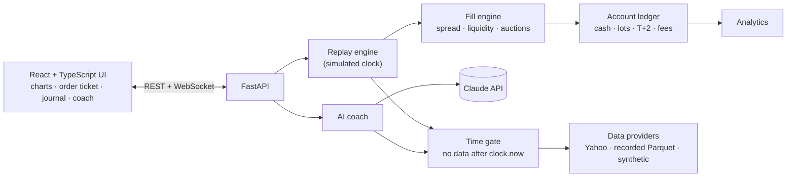

# ASX-sim

[](https://github.com/AryavKarthik/ASX-sim/actions/workflows/ci.yml)

[](LICENSE)

**A realistic ASX trading simulator for learning to day trade, with an AI coach.**

Pick a stock and a past trading day, and ASX-sim replays it minute by minute without
showing you the future. You trade under the same rules as the real market:
- the pre-open phase and the opening single price auction,
- ASX tick sizes and bid/ask spreads,
- liquidity limits and partial fills,
- brokerage and T+2 settlement,
- the closing single price auction.

Then you review every trade with a journal, performance analytics and a Claude-powered
coach that challenges your reasoning instead of handing out tips.

> **Status:** early development. Building toward v1.0 over a 3-week sprint.
> Track progress on the [roadmap](#roadmap).

---

## Why this exists

Free ASX prices are delayed about 20 minutes, which makes them useless for practising day
trading. Real-time feeds cost money. ASX-sim works around this with **intraday replay**:
real historical 1-minute bars, released one at a time by a simulated clock, so practice
sessions feel live and are honest about what you could have known.

## Planned features

- **Three modes, one engine:** intraday replay, daily replay (e.g. step through 2020
  day by day), and live mode on delayed data.
- **Realistic execution:**
  - market, limit, stop, stop-limit and trailing-stop orders; good-for-day or good-till-cancelled,
  - fills modelled from real volume, with participation caps and price impact.
- **ASX market structure:** trading calendar and public holidays, pre-open, opening and
  closing single price auctions with the ASX's randomised timing, trading halts.
- **Account mechanics:** cash vs settled cash (T+2), average cost, realised and unrealised
  P&L, configurable brokerage, dividends and splits.
- **Charts:** candlesticks from 1-minute to monthly, volume, SMA/EMA, VWAP, RSI, MACD,
  Bollinger Bands.
- **Trade journal:** setup, thesis, planned stop and target, emotions, and a post-trade review.
- **Analytics:**
  - equity curve vs the ASX 200,
  - win rate, profit factor, expectancy, max drawdown, Sharpe,
  - performance broken down by setup.
- **AI coach (Claude):** knows your chart, positions and journal. In replay it is technically
  unable to see the future.

## Architecture



Key design decisions are recorded as [Architecture Decision Records](docs/adr/).

## Market data and licensing

ASX-sim's **code** is open source (MIT). **Market data is never committed or published.**
Prices come from Yahoo Finance via `yfinance` for personal, non-commercial use. A scheduled
job records 1-minute bars into a *private* repository, because Yahoo only keeps about 30 days
of 1-minute history. See [ADR 0004](docs/adr/0004-data-licensing.md).

## Getting started

Requires [uv](https://docs.astral.sh/uv/). It installs the right Python version automatically.

```bash
git clone https://github.com/AryavKarthik/ASX-sim.git
cd ASX-sim/backend
uv sync
uv run pytest

# Record the last week of 1-minute bars for a few stocks into ./data
uv run python -m asxsim.data.recorder --out ../data/bars_1m --symbols BHP CBA CSL
```

## Development

| Check | Command (from `backend/`) |
|---|---|
| Lint | `uv run ruff check .` |
| Format | `uv run ruff format .` |
| Types | `uv run mypy src tests` |
| Tests + coverage | `uv run pytest --cov=asxsim` |

Pre-commit hooks run these checks, plus a secret scanner, on every commit:
`uv tool install pre-commit && pre-commit install`.

Commits follow [Conventional Commits](https://www.conventionalcommits.org/).

## Roadmap

- [x] **Day 1:** repo, CI, 1-minute data recorder
- [x] **Day 2:** ASX market rules: tick sizes, trading calendar, trading phases and auctions
- [ ] **Week 1:** core engine (calendar, ticks, clock, fills, ledger) and intraday replay MVP → `v0.1`
- [ ] **Week 2:** full order types, auctions, halts, T+2, journal, analytics
- [ ] **Week 3:** AI coach, daily replay, live mode, watchlists → `v1.0`
- [ ] **Later:** short selling and margin, franking credits, drawing tools, ASX options

## License

[MIT](LICENSE) © 2026 Aryav Karthik. Chart rendering will use
[TradingView Lightweight Charts](https://www.tradingview.com/lightweight-charts/) (Apache-2.0).
