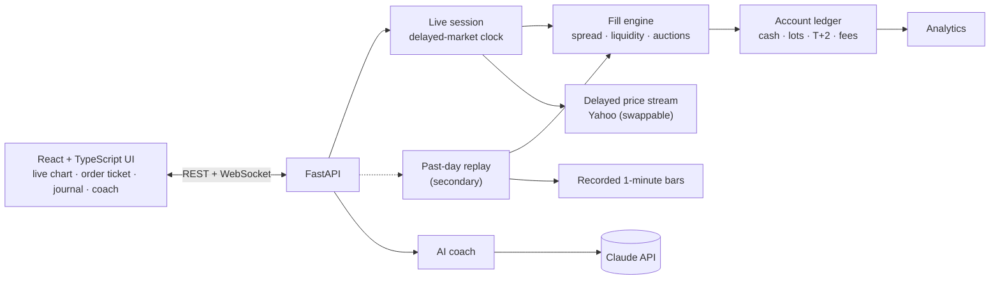

# ASX-sim

[](https://github.com/AryavKarthik/ASX-sim/actions/workflows/ci.yml)

[](LICENSE)

**A realistic ASX day-trading simulator on the live market, with an AI coach.**

Trade ASX shares **during today's trading session**, on free market data that runs about
20 minutes behind the real exchange. Prices stream in continuously, every time a new
(delayed) price is published, and your simulated orders fill against that live feed under
the same rules as the real market:
- the pre-open phase and the opening single price auction,
- ASX tick sizes and bid/ask spreads,
- liquidity limits and partial fills,
- brokerage and T+2 settlement,
- the closing single price auction.

Then you review every trade with a journal, performance analytics and a Claude-powered
coach that challenges your reasoning instead of handing out tips.

> **Status:** early development. Building toward v1.0 over a 3-week sprint.
> Track progress on the [roadmap](#roadmap).

---

## How the 20-minute delay works

Real-time ASX data costs money. Free data (Yahoo Finance) is delayed by about 20 minutes but
still updates continuously. ASX-sim embraces that: **the simulator's market is the real ASX
running 20 minutes behind.**

- If you only watch prices inside ASX-sim, trading feels live. At 10:20am your time you see
  the 10:00 open, and every price change arrives as it is published.
- Your orders are matched against the prices as they arrive, in order, so you can never act
  on a price before the market "reached" it.
- Market phases (pre-open, opening auction, closing auction) follow the same delayed clock.
- The data layer is swappable. Plugging in a real-time feed later (for example Interactive
  Brokers) removes the delay without changing the rest of the app.

## Features

**Core: live day trading on delayed data**
- A streaming feed of delayed prices, updated on every new price (not once a minute),
  with a 1-minute polling fallback if the stream drops.
- A live candlestick chart and quote that update tick by tick, plus a delayed-market clock and
  phase badge.
- **Realistic execution:**
  - market, limit, stop, stop-limit and trailing-stop orders; good-for-day or good-till-cancelled,
  - fills modelled from real volume, with participation caps and price impact.
- **ASX market structure:** trading calendar and public holidays, pre-open, opening and
  closing single price auctions with the ASX's randomised timing, trading halts.
- **Account mechanics:** cash vs settled cash (T+2), average cost, realised and unrealised
  P&L, configurable brokerage, dividends and splits.
- **Charts:**
  - candlesticks and volume at 1, 5, 15 and 60 minutes (built from the session's 1-minute
    candles), plus daily, weekly and monthly with up to decades of history,
  - indicators you can switch on: EMA 9, SMA 20, VWAP, Bollinger Bands, and RSI and MACD in
    their own panels. Each has a plain-English explanation on hover,
  - long-term history stops before the session day, and weekly/monthly bars are built from
    daily bars after that cut-off, so a demo can't see how its own day ends.
- **Trade journal:**
  - fills are grouped into round-trip trades automatically,
  - write your plan (setup, reason, stop, target) on the order ticket and see the risk/reward
    before you buy,
  - review each trade (followed the plan?, what went well, what to improve, emotions, rating),
  - each trade's **R-multiple** (P&L in units of the risk you planned) is worked out for you.
- **Performance analytics** (the Performance view):
  - equity curve against the ASX 200 rescaled to your starting cash. The index never uses
    data past the market clock, so a demo can't leak the rest of the day,
  - net P&L and return vs the ASX 200, win rate, profit factor, payoff ratio, expectancy,
    average R, max drawdown, Sharpe ratio (once there are 5+ trading days), fees as a share of
    gross profit,
  - results by setup, by time of day and by stock, and a discipline check comparing trades
    where you followed your plan with trades where you didn't.
- **AI coach (Claude):** knows your chart, positions and journal, and coaches you during the
  session and afterwards.

**Secondary: look back at past days**
- Replay a recorded past trading day minute by minute, to review what happened or practise
  outside market hours. It uses a replay clock and a time gate so it never shows the future.

## Architecture



Key design decisions are recorded as [Architecture Decision Records](docs/adr/).
[ADR 0008](docs/adr/0008-execution-model.md) explains exactly how simulated orders fill.
[ADR 0007](docs/adr/0007-live-delayed-trading-is-the-core.md) explains the focus on live
delayed trading.

## Market data and licensing

ASX-sim's **code** is open source (MIT). **Market data is never committed or published.**
Prices come from Yahoo Finance via `yfinance` for personal, non-commercial use: a live
stream of delayed prices for trading, plus a scheduled job that records each day's 1-minute
bars into a *private* repository for charts and past-day review. See
[ADR 0004](docs/adr/0004-data-licensing.md).

## Getting started

Requires [uv](https://docs.astral.sh/uv/) (it installs the right Python version
automatically) and [Node.js](https://nodejs.org/) 20+.

**1. Get some market data.** Record the last week of 1-minute bars for a few stocks:

```bash
git clone https://github.com/AryavKarthik/ASX-sim.git
cd ASX-sim/backend
uv sync
uv run python -m asxsim.data.recorder --out ../../ASX-sim-data/bars_1m --symbols BHP CBA CSL
```

By default the app reads data from an `ASX-sim-data` folder next to the repo. Set
`ASXSIM_DATA_DIR` to use somewhere else.

**2. Run the app.** Start the backend and the frontend in two terminals:

```bash
# terminal 1, from backend/
uv run uvicorn asxsim.api.app:app --reload --port 8000

# terminal 2, from frontend/
npm install
npm run dev
```

Then open <http://localhost:5173>. On Windows, `scripts\dev.ps1` does all of this in one
step. The API's interactive docs are at <http://127.0.0.1:8000/docs>.

The app opens on the **Live market (delayed)** tab. During ASX trading hours (about 10:20am
to 4:30pm Sydney time with the delay) your watchlist streams live. Outside those hours it
shows the last session, and **Try the demo** plays a recorded day as if it were live.

## Development

| Check | Command (from `backend/`) |
|---|---|
| Lint | `uv run ruff check .` |
| Format | `uv run ruff format .` |
| Types | `uv run mypy src tests` |
| Tests + coverage | `uv run pytest --cov=asxsim` |

Pre-commit hooks run these checks, plus a secret scanner, on every commit:
`uv tool install pre-commit && pre-commit install`.

Commits follow [Conventional Commits](https://www.conventionalcommits.org/).

## Roadmap

- [x] **Day 1:** repo, CI, daily 1-minute data recorder
- [x] **Day 2:** ASX market rules: tick sizes, trading calendar, trading phases and auctions
- [x] **Day 3:** first clickable app (currently a past-day replay viewer): chart, clock, time gate, WebSocket stream
- [x] **Live delayed market (top priority):** watchlist of up to 20 stocks streaming Yahoo's delayed prices as they update (with a polling fallback), live candles and quotes that tick with every price, measured delay, delayed-market clock and phases, and a demo mode for outside market hours. *Verified live on 16 Nov 2026: updates about every second for busy stocks, a 20.0-minute delay, real bid/ask included (see ADR 0007).*
- [x] **Trading on the live market:** order ticket (market and limit), fills at the delayed prices shown with spread, liquidity caps, partial fills and opening/closing auctions, ASX rules ($500 first parcel, price steps, no shorting), brokerage, cash, buying power, holdings, P&L, positions/orders/fills, saved account → `v0.1`
- [x] **Week 2, part 1:** stop, stop-limit and trailing-stop orders (broker-side conditional orders), good-till-cancelled orders, T+2 settlement
- [x] **Week 2, part 2:** trade journal (round-trip trades, plan on the ticket, review, R-multiple) and a price refresh setting (Live / 5s / 30s)
- [x] **Week 2, part 3:** performance analytics (equity vs ASX 200, trade statistics, drawdown, Sharpe, breakdowns, discipline)
- [x] **Week 2, part 4:** chart timeframes (1m to monthly) and indicators (EMA, SMA, VWAP, Bollinger, RSI, MACD)
- [x] **Week 2, part 5:** trading halts, inferred from the feed, with a reopening auction ([ADR 0009](docs/adr/0009-inferred-trading-halts.md))
- [ ] **Week 3:** AI coach, watchlists, security pages, deploy → `v1.0`
- [ ] **Secondary:** trading inside past-day replay, daily replay over longer periods
- [ ] **Later:** real-time data provider, short selling and margin, franking credits, drawing tools, ASX options

## License

[MIT](LICENSE) © 2026 Aryav Karthik. Chart rendering uses
[TradingView Lightweight Charts](https://www.tradingview.com/lightweight-charts/) (Apache-2.0).
